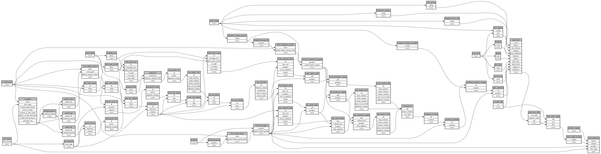

```
# AUTOGENERATED BY ECOSCOPE-WORKFLOWS; see fingerprint in README.md for details

```

```yaml
# fingerprint:
artifacts_sha256_basic: 855ac6d4d2d7d2bec6dedf7308eec195314ced6df6755a07336fff2db2b486f1
artifacts_sha256_strict: 70de41e1ed97a12c7b85a1a3d5f99b2a9bdc9d1f33830ba19fd647509e2acb1f
installed_requirements:
- channel: conda-forge
  name: python
  version: {version: ==3.12.15}
- channel: https://repo.prefix.dev/ecoscope-workflows/
  name: lonboard
  version: {version: ==0.0.8}
- channel: conda-forge
  name: numpy
  version: {version: ==2.0.2}
- channel: conda-forge
  name: pyarrow
  version: {version: ==23.0.1}
- channel: conda-forge
  name: pydantic
  version: {version: ==2.8.2}
- channel: conda-forge
  name: rasterio
  version: {version: ==1.4.4}
- channel: conda-forge
  name: pydeck
  version: {version: ==0.9.2}
params_sha256: 13a848544b444ea88f6188b3d11ce685e570f4aec51d58f0fa4bf65563cf2a41
spec_sha256: f42c93411a78609251598ca7675d8cbda2feca51c80b05303be9a71ce3521120

```

# ecoscope-workflows-patrol-effort-plot-workflow


