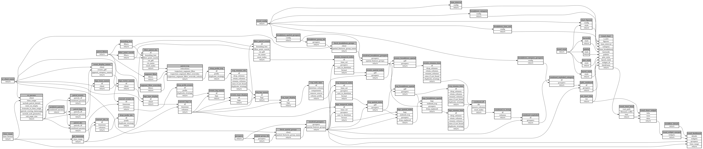

```
# AUTOGENERATED BY ECOSCOPE-WORKFLOWS; see fingerprint in README.md for details

```

```yaml
# fingerprint:
artifacts_sha256_basic: 75678ff7d089b592d17dfd6185b40c13c947f0b981b7583394dfda63e87f5ee8
artifacts_sha256_strict: 6d7a115c07d0d565cef30a61243b974c994c1ea076dfb66b1b85d4997bbb13fc
installed_requirements:
- channel: conda-forge
  name: python
  version: {version: ==3.12.16}
- channel: https://repo.prefix.dev/ecoscope-workflows/
  name: ecoscope-platform
  version: {version: ==2.39.4}
- channel: https://repo.prefix.dev/ecoscope-workflows/
  name: lonboard
  version: {version: ==0.0.8}
- channel: conda-forge
  name: pydeck
  version: {version: ==0.9.2}
params_sha256: 5ad9d0d59cb7ff5041ce2b0060ae47ebe451291cb6e7e441cbc964a5114f9cb2
spec_sha256: 55c665abf565b7b04e1f47616327b544ad1ec7cf23d2d98cb3285a3f320d1828

```

# ecoscope-workflows-patrol-effort-plot-workflow


