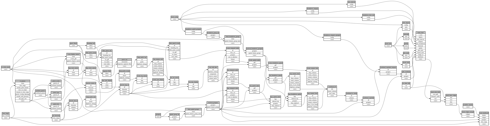

```
# AUTOGENERATED BY ECOSCOPE-WORKFLOWS; see fingerprint in README.md for details

```

```yaml
# fingerprint:
artifacts_sha256_basic: 784d2be4201217daaac5d1cc11eb90d41f55c9f6e8d26f7806a00f61c52d2dfb
artifacts_sha256_strict: 6228e8ba6dcc3e50c78540b04e4e43ea444a42f2e5e45d451c4100a0718635e3
installed_requirements:
- channel: conda-forge
  name: python
  version: {version: ==3.12.16}
- channel: https://repo.prefix.dev/ecoscope-workflows/
  name: ecoscope-platform
  version: {version: ==2.30.1}
- channel: https://repo.prefix.dev/ecoscope-workflows/
  name: lonboard
  version: {version: ==0.0.8}
- channel: conda-forge
  name: pydeck
  version: {version: ==0.9.2}
params_sha256: 36dbb3fb9df2887bb646b099906f253b233547e95ba488dddfb1be5bbc99ad6a
spec_sha256: d905ea457a843a7780bc7a8f20d3c7a3e4696c4a9ad7d737084dec5e94905159

```

# ecoscope-workflows-patrol-effort-plot-workflow


